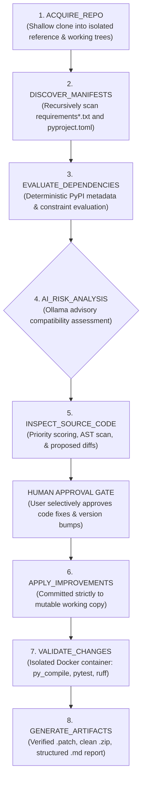

# Dependency Upgrade Assistant 📦
### AI-Powered Repository Analysis and Improvement Platform

[](https://github.com/soham/dependency-upgrade-assistant/actions/workflows/ci.yml)
[](https://www.python.org/)
[](LICENSE)
[](tests/)

The **Dependency Upgrade Assistant** is an interactive, security-first developer platform designed to analyze Python repositories, evaluate dependency upgrade candidates, inspect source code for quality findings with local Ollama AI models, safely validate approved changes in an isolated Docker sandbox, and export verified, Git-compatible deliverables.

Developed under the **AI-Driven Development Life Cycle (AI-DLC)** with strict human-in-the-loop approval gating, deterministic verification, and full provenance traceability.

---

## 1. Project Overview & Problem Statement

Maintaining open-source and enterprise Python repositories requires regular dependency updates and proactive refactoring. However:
- Blindly bumping versions risks silent breakages, conflicting constraints, and runtime regressions.
- Cloud-based AI refactoring tools often demand excessive repository permissions (forking, automated pull requests, remote commits) and risk leaking private tokens or proprietary intellectual property.
- Running untrusted repository test suites directly on the host development machine exposes developers to malicious setup scripts and arbitrary code execution.

The **Dependency Upgrade Assistant** solves this by providing a local, headless-capable, sandboxed platform that:
1. Clones repositories into ephemeral, isolated workspaces while cryptographically preserving the original reference copy.
2. Evaluates dependencies deterministically using PyPI metadata and local fallback catalogs.
3. Provides advisory risk analysis and targeted code improvements via locally hosted Ollama LLMs.
4. Enforces an unconditional **Human Approval Gate** before any modifications touch files.
5. Safely validates changes inside a locked-down, unprivileged Docker container (or marks them `NOT_RUNNABLE` if Docker is unavailable).
6. Delivers pre-validated unified patches (`.patch`), clean ZIP archives (`.zip`), and comprehensive Markdown audit reports (`.md`).

---

## 2. Features & Capabilities

### Tab 1: Repository Analysis & Improvement Platform (Phase 2)
- **Git Acquisition:** Shallow clones (`--depth 1`) public or private GitHub repositories.
- **In-Memory Credential Safety:** Personal Access Tokens (PATs) are held strictly in memory and delivered via `GIT_ASKPASS`. Tokens are never written to disk, CLI arguments, URLs, logs, or LLM prompts.
- **Multi-Manifest Discovery:** Recursively detects `requirements.txt`, `requirements-dev.txt`, nested `-r`/`-c` files, and PEP 621 / PEP 735 / Poetry `pyproject.toml` manifests with circular reference safeguards.
- **Deterministic 4-Tier Dependency Analysis:** Live PyPI metadata queries (with in-memory caching) and local catalog fallback; evaluates constraint satisfaction and cross-manifest conflicts.
- **Advisory AI Compatibility Risk:** Evaluates breaking changes and deprecated APIs using local Ollama models.
- **Priority Source Code Inspection:** Heuristically discovers and scores up to $N$ source files (default: 10), filtering out caches, virtual environments, binaries, and detected credentials.
- **Static AST & AI Code Quality Scanning:** Detects dangerous calls (`eval`, `exec`, `subprocess(shell=True)`), bare `except:` clauses, and synthesizes targeted fixes.
- **Strict AST Pre-Validation:** All proposed code improvements are verified with `ast.parse()` before being presented to the user.
- **Human Approval Gate:** Users explicitly select which dependency bumps and code improvements to accept; zero suggestions are auto-applied.
- **Isolated Docker Sandbox:** Executes test suites and syntax bytecode compilation inside a non-root container with `--network none`, resource limits, and read-only reference mounts.
- **Verified Deliverables:** Produces a `.patch` verified via `git apply --check`, a clean `.zip` verified via `testzip()`, and a structured `.md` report.

### Tab 2: Single Manifest Review (Phase 1 Baseline)
- **Direct Ingestion:** Upload or paste `requirements.txt` manifests directly in the browser.
- **Semantic Comparison:** PEP 440 semantic comparison via `packaging.version.Version`.
- **Lossless Line Preservation:** Retains comments, blank lines, pip flags, URLs, and environment markers byte-for-byte.
- **Interactive Review Table:** Select or deselect individual updates.
- **Unified Diff Viewer:** Side-by-side git diff view with instant `.txt` manifest download.

---

## 3. System Architecture

The application adopts a modular, headless-core architecture completely decoupled from Streamlit:

```
┌────────────────────────────────────────────────────────────────────────┐
│                        Streamlit Web Interface                         │
│                              (src/app.py)                              │
│   ├── Tab 1: Repository Analysis & Improvement Platform               │
│   └── Tab 2: Single Manifest Review (Original Phase 1 Workflow)        │
└───────────────────────────────────┬────────────────────────────────────┘
                                    │ Pure Python API Calls
                                    ▼
┌────────────────────────────────────────────────────────────────────────┐
│                        Pipeline Orchestrator                           │
│                    (src/pipeline/orchestrator.py)                      │
│   Coordinates 8 discrete stages, state tracking, and callbacks         │
└───────┬──────────┬──────────┬──────────┬──────────┬──────────┬─────────┘
        │          │          │          │          │          │
        ▼          ▼          ▼          ▼          ▼          ▼
 ┌────────────┐ ┌──────────┐ ┌──────────┐ ┌─────────┐ ┌────────┐ ┌────────┐
 │Git Service │ │Manifest  │ │Dependency│ │Ollama   │ │Code    │ │Sandbox │
 │& Workspace │ │Scanner   │ │Analyzer  │ │Client   │ │Improver│ │Runner &│
 │Manager     │ │& PyProject│ │(PyPI +   │ │(Local   │ │(AST pre│ │Exporter│
 │            │ │Parser    │ │ Catalog) │ │ Models) │ │ check) │ │        │
 └────────────┘ └──────────┘ └──────────┘ └─────────┘ └────────┘ └────────┘
```

---

## 4. Pipeline Stages & Data Flow



1. **`ACQUIRE_REPO`:** Validates GitHub URL, clones into `reference/`, creates `working/` mirror, records commit SHA.
2. **`DISCOVER_MANIFESTS`:** Traverses workspace, handles `-r`/`-c` includes, avoids circular references.
3. **`EVALUATE_DEPENDENCIES`:** Queries PyPI JSON API with in-memory cache, checks constraints, detects cross-manifest conflicts.
4. **`AI_RISK_ANALYSIS`:** Queries local Ollama model for advisory breaking changes and deprecations.
5. **`INSPECT_SOURCE_CODE`:** Prioritizes entry points and dependency-referencing files, runs static AST visitor, generates proposed diffs.
6. **`APPLY_IMPROVEMENTS`:** Human-approval-gated application to `working/` copy only; cryptographically asserts `reference/` remains untouched.
7. **`VALIDATE_CHANGES`:** Runs containerized syntax checks and test suites; falls back to `NOT_RUNNABLE` if Docker is unavailable.
8. **`GENERATE_ARTIFACTS`:** Validates patch with `git apply --check`, tests ZIP with `testzip()`, and synthesizes full Markdown report.

---

## 5. Project Directory Structure

```text
dependency-upgrade-assistant/
├── .github/workflows/ci.yml       # GitHub Actions CI matrix workflow
├── aidlc-docs/                    # Formal AI-DLC governance, requirements & audit logs
│   ├── approvals/                 # Human review approval log (Phase 1 & Phase 2)
│   ├── prompts/                   # Prompt records and iteration logs
│   └── requirements/              # Software Requirements Specifications (SRS)
├── plan/                          # Architectural roadmaps and implementation plans
├── sample-data/                   # Test fixtures and sample manifests
│   ├── sample_repo/               # Complete controlled end-to-end fixture repository
│   │   ├── requirements.txt       # Outdated and up-to-date dependency declarations
│   │   ├── pyproject.toml         # PEP 621 package metadata
│   │   ├── src/sample_app/        # Source code with intentional quality findings
│   │   └── tests/test_sample.py   # Deterministic fixture test suite
│   ├── requirements-outdated.txt  # Phase 1 outdated sample
│   ├── requirements-clean.txt     # Phase 1 clean sample
│   └── requirements-complex.txt   # Phase 1 complex sample (markers & flags)
├── src/
│   ├── analysis/                  # Source code and dependency analysis engines
│   │   ├── code_improver.py       # AST pre-validated snippet replacer & diff generator
│   │   ├── code_inspector.py      # File prioritization & static AST security scanner
│   │   ├── dependency_analyzer.py # Cached PyPI client & multi-tier evaluation
│   │   ├── manifest_scanner.py    # Recursive manifest discovery & include resolver
│   │   └── pyproject_parser.py    # PEP 621, PEP 735 & Poetry TOML parser
│   ├── core/                      # Phase 1 core logic (comparator, diff, parser)
│   ├── data/                      # Local package catalog dataset and loader
│   ├── pipeline/                  # Pipeline orchestration
│   │   └── orchestrator.py        # Eight-stage state machine & callback coordinator
│   ├── services/                  # External runtime & workspace integrations
│   │   ├── exporter.py            # Verified .patch, .zip, and .md report exporter
│   │   ├── git_service.py         # Secure shallow clone & GIT_ASKPASS credential handler
│   │   ├── ollama_client.py       # Local Ollama client with dynamic model discovery
│   │   └── workspace_manager.py   # Isolated dual-copy workspace manager
│   ├── validation/                # Sandboxed validation engine
│   │   ├── sandbox_manager.py     # Docker container sandbox (non-root, network: none)
│   │   ├── test_runner.py         # Whitelisted validation runner (py_compile, pytest)
│   │   └── validator.py           # Multi-stage validation coordinator
│   └── app.py                     # Streamlit dual-tab web application
├── tests/                         # Complete automated test suite (146 tests)
│   ├── test_e2e_scenarios.py      # 13 end-to-end pipeline scenario tests
│   ├── test_orchestrator_integration.py # Pipeline orchestrator integration tests
│   └── test_*.py                  # Unit tests for all individual modules
├── pyproject.toml                 # Root project metadata & dependencies
├── requirements.txt               # Pinned project dependencies
└── README.md                      # Comprehensive documentation
```

---

## 6. Installation & Setup

### Prerequisites
- Python 3.10 through 3.14 (`python3 --version`).
- Git 2.30+ (`git --version`).
- Optional: Local [Ollama](https://ollama.com/) runtime for AI features.
- Optional: [Docker](https://www.docker.com/) for isolated sandbox validation.

### Setup Instructions
```bash
# 1. Clone the repository
git clone https://github.com/soham/dependency-upgrade-assistant.git
cd dependency-upgrade-assistant

# 2. Create and activate a virtual environment
python3 -m venv .venv
source .venv/bin/activate
# Windows: .venv\Scripts\activate

# 3. Install dependencies
pip install --upgrade pip
pip install -r requirements.txt
```

---

## 7. Streamlit Application Startup

Launch the interactive dual-tab application locally:

```bash
streamlit run src/app.py
```

The browser interface will open at `http://localhost:8501`:
- **Tab 1: Repository Analysis & Improvement:** Paste any GitHub URL to run the complete 8-stage pipeline.
- **Tab 2: Single Manifest Review:** Paste or upload `requirements.txt` to review dependency updates against the local catalog.

---

## 8. Ollama Integration & Model Discovery

The platform connects to the locally installed Ollama daemon at `http://localhost:11434`:
- **Dynamic Discovery:** Automatically queries `GET /api/tags` to populate available models. Does not assume hardcoded model names or trigger automatic downloads.
- **Structured JSON Mode:** Enforces JSON schema output (`POST /api/chat` with `format: "json"`) with markdown code-block extraction fallback.
- **Graceful Degradation:** If Ollama is offline or uninstalled, the application operates in deterministic mode without failing.

To install and pull models locally:
```bash
# Install Ollama (macOS/Linux)
curl -fsSL https://ollama.com/install.sh | sh

# Pull desired models
ollama pull llama3.1:8b
ollama pull gemma3:4b
```

---

## 9. Docker Sandbox Architecture & Security Restrictions

Untrusted repository code is **never executed directly on the host development machine**:

| Security Control | Implementation |
| :--- | :--- |
| **Execution Environment** | Locked-down Docker container (Default image: `python:3.11-slim`). |
| **User Privileges** | Non-root user (`--user=1000:1000`). Root and `--privileged` strictly forbidden. |
| **Network Access** | Completely disabled (`--network none`). No egress/ingress permitted. |
| **Resource Limits** | `--memory=512m`, `--cpus=1.0`, `--pids-limit=64`. |
| **Timeout Boundary** | Subprocess timeout strictly enforced (default: 30s syntax, 60s tests). |
| **Volume Mounts** | Pristine `reference/` mounted **read-only** (`:ro`). `working/` mounted read-write (`:rw`). |
| **Docker Socket** | Mounting `/var/run/docker.sock` is strictly rejected and throws security errors. |
| **Fail-Closed Fallback** | If Docker is inactive, tests are categorized as `NOT_RUNNABLE` and skipped. |

---

## 10. Dependency Analysis Methodology

1. **Candidate Availability:** Queries the official PyPI JSON API (`https://pypi.org/pypi/<pkg>/json`). Responses are cached in memory to minimize external requests. Offline fallback to `src/data/package_catalog.json`.
2. **Constraint Verification:** Evaluates version compatibility using `packaging.specifiers.SpecifierSet` and `packaging.version.Version`.
3. **Cross-Manifest Conflict Detection:** Identifies conflicting versions declared across multiple manifests.
4. **Advisory Risk Classification:** Categorizes upgrades as `LOW`, `MEDIUM`, or `HIGH` risk based on breaking change analysis.

---

## 11. Human Approval Workflow

The platform enforces strict human-in-the-loop governance:
1. Proposed code fixes are generated as uncommitted snippets and unified diffs.
2. In the Streamlit UI, findings are displayed with explanations, line ranges, and diff previews.
3. Users toggle checkboxes to explicitly approve or reject individual fixes.
4. Unchecked improvements are completely omitted from the working copy.

---

## 12. Artifact Exporter & Deliverable Validation

All outputs are validated before being made available for download:

1. **Unified Patch (`.patch`):**
   - Synthesizes Git-compatible diffs between `reference/` and `working/`.
   - Pre-validated using `git apply --check` against an isolated clean copy of the reference repo.
   - Detects binary changes and explicitly notes them as unsupported.
2. **Improved Repository Archive (`.zip`):**
   - Archives the improved working tree while strictly excluding `.git`, `.venv`, caches, build directories, and secrets (`.env`, `*.key`, `*.pem`).
   - Verified intact using `zipfile.ZipFile.testzip()` CRC checks and isolated extraction testing.
3. **Analysis Report (`.md`):**
   - Detailed Markdown report logging all 8 stages, findings, metrics, and deliverable integrity statuses.

---

## 13. Automated Test Execution

Run the complete 146-test test suite:

```bash
# Run all tests with verbose output
pytest -v

# Run only end-to-end scenario tests
pytest -v tests/test_e2e_scenarios.py

# Run only orchestrator integration tests
pytest -v tests/test_orchestrator_integration.py
```

### Test Suite Breakdown & Verification Distinctions
- **Phase 1 Baseline:** 27 tests (Parser, Comparator, Diff Generator, Catalog Loader).
- **Milestone 1:** 16 tests (Git Acquisition & Workspace Management).
- **Milestone 2:** 22 tests (Ollama Client & Dynamic Model Discovery).
- **Milestone 3:** 21 tests (Manifest Scanner & PyProject Parser).
- **Milestone 4:** 15 tests (Code Inspector & AI Code Improver).
- **Milestone 5:** 13 tests (Docker Sandbox Manager & Validator).
- **Milestone 6:** 8 tests (Artifact Exporter & Deliverable Validation).
- **Milestone 7:** 11 tests (Pipeline Orchestrator & Streamlit UI Integration).
- **Milestone 8:** 13 tests (End-to-End Scenario Verification against Fixtures).
- **Total Local Unit & Integration Tests:** **146 passed in ~0.55s** (100% pass rate).

### Verification Categories & Evidence
- **Unit and Integration Tests:** 146 tests executed locally in the development virtualenv against Python 3.14.3.
- **Mocked Security Verification:** Security policies (`--user=1000:1000`, `--network none`, resource limits, read-only reference mount `:ro`, Docker socket mount rejection) are verified via mocked unit tests in `tests/test_sandbox_manager.py` and `tests/test_validator.py`.
- **Live Docker Verification:** When Docker is not present on the host, the engine empirically halts and classifies test execution as `NOT_RUNNABLE`. Live container runs were not performed on this host because no Docker binary is installed.
- **Local CI-Equivalent Execution:** Executed locally via `pytest -v` in `.venv`.
- **Remote CI Results:** Configured in `.github/workflows/ci.yml` across Python 3.10, 3.11, 3.12, 3.13, and 3.14. Remote matrix results are generated only upon pushing commits to GitHub.

---

## 14. Known Limitations & Technical Caveats

1. **Advisory AI Analysis:** Ollama LLM evaluations provide qualitative advisory guidance, not authoritative mathematical proof of software compatibility.
2. **PyPI & Catalog Ground Truth:** Dependency availability and version ordering rely strictly on PyPI JSON metadata and PEP 440 packaging standards.
3. **AST Pre-Validation:** Syntax pre-validation with `ast.parse()` verifies Python syntax correctness before disk writes, but does not prove semantic runtime correctness.
4. **Docker Availability:** If Docker is not running on the host, repository tests will be reported as `NOT_RUNNABLE`. The tool will never execute untrusted code on the host machine.
5. **Zero Remote Modification:** The tool never pushes commits, modifies branches, creates pull requests, or forks repositories on GitHub.
6. **Reference Tree Ground Truth:** The pristine reference clone is read-only and cryptographically verified before and after improvements to ensure zero file mutation.

---

## License

This project is licensed under the MIT License.
