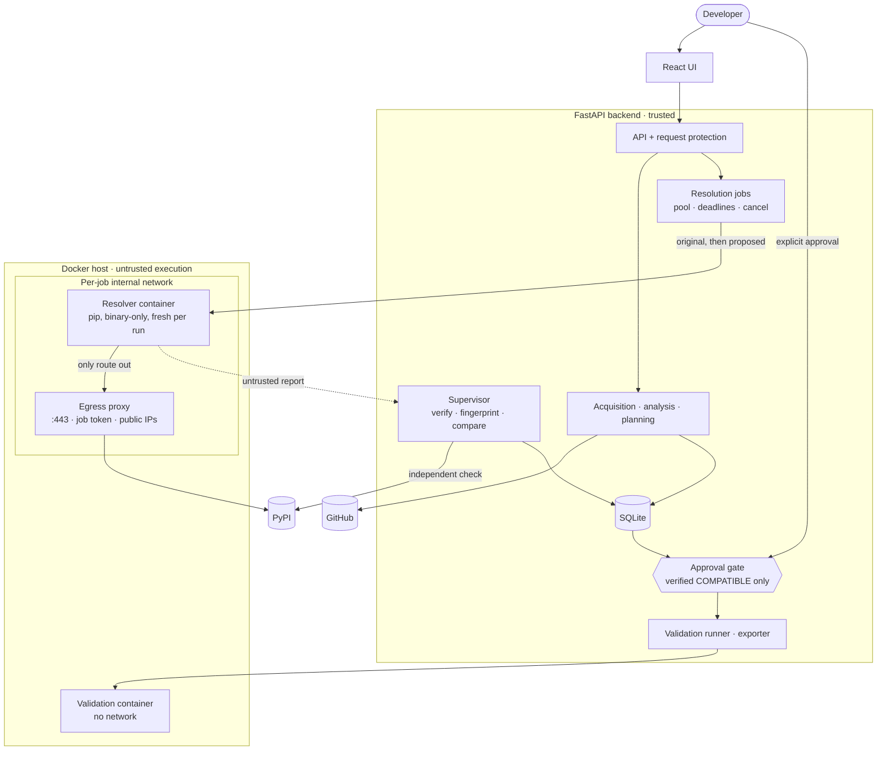

<div align="center">


<h1>DEPENDENCY UPGRADE ASSISTANT</h1>

<p><strong>Resolve the whole set. Verify the evidence. Approve the exact change.</strong></p>

<p>A local, security-conscious workflow for upgrading Python dependencies: it resolves the complete
proposed dependency set with pip inside an isolated container, verifies the result independently,
and only then lets a human approve, validate and export the change.</p>

<p>
<a href="https://github.com/Soham-Pasalkar/dependency-upgrade-assistant/actions/workflows/ci.yml"></a>


</p>

<p>
<a href="#how-it-works">How it works</a> ·
<a href="#getting-started">Getting started</a> ·
<a href="#api">API</a> ·
<a href="#testing">Testing</a> ·
<a href="#scope-and-limitations">Limitations</a> ·
<a href="docs/RESOLUTION_ENGINE.md">Resolution engine</a>
</p>

</div>

---

## Why this exists

Upgrading one package is rarely about that one package. `requests` 2.32 may exist on PyPI, but whether
it works *with everything else your project already pins* depends on the full graph: transitive
requirements, environment markers, extras, `Requires-Python`, constraints files and which releases
actually ship a wheel for your platform. A version that exists is not a version that resolves.

DUA treats compatibility as something to **prove**, not assume:

- pip's own resolver resolves the **complete proposed set** for a fixed target (CPython 3.11.18, Linux)
  in a disposable container;
- a trusted supervisor in the backend re-checks every selected file and every dependency edge against
  PyPI before the result counts as evidence;
- a person approves the **exact** diff, bound to that evidence, before anything is validated or exported;
- validation runs the project's tests in a network-less sandbox, never on your machine.

> [!IMPORTANT]
> **Compatible means the complete dependency set resolves. It does not mean the packages are vetted or
> safe.** DUA does not perform malware detection and does not check vulnerability advisories. Review the
> packages an upgrade introduces before approving.

## Features

| Area | What DUA does |
|---|---|
| **Acquisition** | Shallow, hardened clone of a public GitHub repository (or a pasted/uploaded manifest); recursive discovery of `requirements*.txt`, `pyproject.toml` and `package.json` |
| **Analysis** | Dependency parsing and registry lookups (PyPI, npm) with explicit data-source labels; optional local Ollama advisory notes with a deterministic fallback |
| **Planning** | Upgrade recommendations, an upgrade plan and a unified diff with patch-integrity checks |
| **Compatibility (Python)** | pip resolution of the original *and* the proposed manifest in fresh containers; direct and transitive packages; introduced-package comparison; exact-file upload dates; conflict causes; explicit `UNSUPPORTED` reasons |
| **Isolation** | Digest-pinned image, non-root, read-only, no capabilities, no DNS, no host mounts beyond read-only inputs; egress only through a per-job allow-listing proxy to `pypi.org` and `files.pythonhosted.org` |
| **Evidence** | Supervisor-verified reports with separate, server-computed fingerprints for each run; stale or replayed evidence never counts |
| **Jobs** | SQLite-backed jobs with a bounded worker pool, cancellation, deadlines and restart recovery |
| **Approval** | Explicit human approval bound to the diff checksum, the validation policy and the verified resolution fingerprint; no override |
| **Validation** | The repository's tests in a Docker sandbox with `--network none` and offline-staged wheels |
| **Export** | `.patch`, `summary.json`, `compatibility-report.md`, `execution.log`, `checksums.sha256` and a verified `.zip` |

## How it works



The resolver and everything it prints are **untrusted**. The supervisor parses the report strictly,
matches every selected wheel by filename, URL and SHA-256 in PyPI's index, fetches each wheel's metadata
itself and proves the closure (requirements, markers, extras, constraints, `Requires-Dist`,
`Requires-Python`, nothing missing, nothing unrelated). Only an exit code of 0 plus a verified report can
become `COMPATIBLE`. Approval, validation, apply and export all re-check that evidence on the server.

### The workflow

1. **Acquire** a public GitHub repository, or paste/upload a manifest.
2. **Discover and analyze** the dependency manifests.
3. **Recommend** upgrades.
4. **Plan** the change and review the unified diff.
5. **Resolve the original** dependency set (the baseline).
6. **Resolve the proposed** dependency set (the evidence that matters).
7. **Verify** both reports independently against PyPI.
8. **Compare** the two resolved environments.
9. **Review** the packages the upgrade introduces, with their exact upload dates.
10. **Approve** the exact diff (offered only after a verified compatible result).
11. **Validate** in the network-less sandbox.
12. **Export** the patch, reports and checksums.

When the proposed set does not resolve, DUA shows pip's conflict causes and keeps approval locked.
Unsupported input (npm, `pyproject.toml`, `-r`, `-e`, URLs, index options, source-only packages) is
reported item by item. If Docker is unavailable, the check reports **Resolver unavailable**; nothing can
be approved until a check succeeds. A failed or timed-out check is never shown as compatible.

Full details: [docs/RESOLUTION_ENGINE.md](docs/RESOLUTION_ENGINE.md).

## Technology

| Layer | Technology |
|---|---|
| Backend | Python 3.10+ (CI: 3.10–3.14), FastAPI, Pydantic v2 and pydantic-settings, Uvicorn, `packaging`, `requests` |
| Frontend | React 19, TypeScript, Vite; Vitest and Testing Library; oxlint |
| Persistence | SQLite (`dua_local.db` by default) |
| Isolation | Docker; pinned `python:3.11-slim` and `node:20-slim` images by digest |
| Resolution | pip (inside the pinned image) against PyPI |
| Optional | Ollama for advisory notes (never used for compatibility decisions) |
| CI | GitHub Actions: Python matrix, frontend, and a Docker job with live resolver, egress and browser tests |

## Getting started

### Prerequisites

| Requirement | Notes |
|---|---|
| Git | |
| Python ≥ 3.10 | 3.10–3.14 are tested in CI |
| Node.js 22 and npm | Node 22 is what CI uses |
| Docker Engine or Docker Desktop | Required for compatibility checks and sandbox validation. The backend user must be able to run `docker`. Default limits: 1 GB RAM and 512 MB scratch per resolver run, up to two concurrent jobs |
| Internet access | GitHub (acquisition), PyPI (analysis, resolution through the proxy, supervisor verification) |

> [!NOTE]
> The verified environment is Linux with Docker 29 (CI). Docker Desktop on macOS/Windows has not been
> verified for the resolver's network isolation.

### Install

```bash
git clone https://github.com/Soham-Pasalkar/dependency-upgrade-assistant.git
cd dependency-upgrade-assistant

python3 -m venv .venv
source .venv/bin/activate
pip install -e ".[dev]"

npm --prefix frontend ci

cp .env.example .env            # optional; every setting has a default

# Resolver image, pinned by digest (otherwise pulled on first use)
docker pull python:3.11-slim@sha256:07d4824036af339fa1b6ef769cc99d9c10a141769538b52b3b597c84f7a7b535
```

### Run

```bash
# Terminal 1: backend on http://127.0.0.1:8000 (Swagger UI at /docs)
source .venv/bin/activate
python -m uvicorn src.api.main:app --host 127.0.0.1 --port 8000

# Terminal 2: frontend on http://localhost:5173 (proxies /api to the backend)
npm --prefix frontend run dev
```

Open <http://localhost:5173> and click **Analyze a repository**. Enter a public GitHub URL, or switch to
**Manifest** and paste one such as:

```text
requests==2.28.0
urllib3==1.26.5
```

Generate recommendations and a plan, click **Check compatibility**, review the result, approve, validate
and export. A step-by-step demo is in [docs/SETUP_AND_DEMO_GUIDE.md](docs/SETUP_AND_DEMO_GUIDE.md).

### Configuration

Settings are read from the environment or `.env`. Resolver values outside their range stop the backend
from starting.

| Variable | Default | Purpose |
|---|---|---|
| `ENVIRONMENT` | `development` | `production` requires explicit `CORS_ORIGINS` |
| `HOST`, `PORT` | `127.0.0.1`, `8000` | API bind address |
| `DATABASE_PATH` | `dua_local.db` | SQLite file |
| `WORKSPACE_ROOT` | `~/.dua/workspaces` | Cloned repository workspaces |
| `CORS_ORIGINS` | `[]` | Allowed browser origins (never `*`) |
| `DEV_FRONTEND_PORTS` | `[5173,5174,4173,3000]` | Loopback ports trusted in development |
| `ALLOWED_HOSTS` | `["localhost","127.0.0.1","::1"]` | Accepted `Host` headers |
| `PLAN_RETENTION_HOURS` | `24` (≤ 720) | How long plans, approvals and evidence stay usable |
| `EXPORT_RETENTION_HOURS` | `24` (≤ 8760) | Export retention |
| `RUN_RETENTION_HOURS` | `168` (≤ 8760) | Analysis run retention |
| `OLLAMA_BASE_URL` | `http://127.0.0.1:11434` | Optional advisory model server |
| `OLLAMA_DEFAULT_MODEL` | `llama3:latest` | Advisory model |
| `DOCKER_TIMEOUT_SECONDS`, `DOCKER_MAX_MEMORY_MB`, `DOCKER_MAX_CPUS` | `60`, `512`, `1.0` | Validation sandbox limits |
| `RESOLVER_TIMEOUT_SECONDS` | `180` (1–600) | Per-run budget T; a job is bounded by 2T |
| `RESOLVER_MEMORY_MB` | `1024` (1–4096) | Memory per resolver container |
| `RESOLVER_CPUS` | `1` (1–4) | CPUs per resolver container |
| `RESOLVER_PIDS_LIMIT` | `256` (1–1024) | Processes per resolver container |
| `RESOLVER_TMPFS_MB` | `512` (1–2048) | Scratch space per resolver container |
| `RESOLVER_MAX_CONCURRENT` | `2` (1–4) | Concurrent resolution jobs |
| `RESOLVER_MAX_REPORT_MB` | `10` (1–50) | Resolver report size cap |
| `RESOLVER_MAX_PACKAGES` | `500` (1–2000) | Packages per resolution |

No secrets are required. Never commit `.env`.

## Docker and isolation

Running the app does not need Docker; **verifying compatibility and validating a change do.** Without
Docker the UI still analyzes and plans, but every compatibility check reports *Resolver unavailable* and
approval stays locked.

For each check DUA creates a per-job Docker network with no route out and no address on the host, starts
an egress proxy on it, and runs pip in a **fresh container per run** (original, then proposed). The
resolver has no DNS and no direct network; it can reach only the proxy, which accepts encrypted
connections to `pypi.org` and `files.pythonhosted.org` on port 443, checks the job's token, resolves
names itself and refuses any private, loopback, link-local or metadata address. Resolution is
**binary-only** (`--only-binary=:all:`), so no package build scripts run; packages available only as
source are reported as unsupported. Containers and networks are removed after each job, and a labelled
sweep cleans up after crashes.

## API

Interactive OpenAPI documentation is served at <http://127.0.0.1:8000/docs>. State-changing requests
must come from an allowed origin and carry `X-DUA-Client: web` (the frontend does this).

| Method | Path | Purpose |
|---|---|---|
| `GET` | `/api/health` | Health check |
| `POST` | `/api/repositories/analyze` | Clone and analyze a public GitHub repository |
| `POST` | `/api/runs/manifest` | Analyze a pasted or uploaded manifest |
| `GET` | `/api/runs/{run_id}` | Analysis run |
| `POST` | `/api/runs/{run_id}/manifests/{index}/recommendations` | Recommendations for a manifest |
| `POST` | `/api/runs/{run_id}/manifests/{index}/plan` | Build the upgrade plan and diff |
| `POST` | `/api/proposals/{proposal_id}/resolve` | Start the compatibility check (`202` with a job, or `200` when input is unsupported) |
| `GET` | `/api/proposals/{proposal_id}/resolution` | Status, both resolved sets, comparison, upload dates, disclosure |
| `GET` | `/api/jobs/{job_id}` | Resolution job status |
| `POST` | `/api/jobs/{job_id}/cancel` | Cancel a resolution job |
| `POST` | `/api/proposals/{proposal_id}/approve` | Approve the exact diff (requires verified `COMPATIBLE` evidence) |
| `GET` | `/api/proposals/{proposal_id}/approval` | Approval state |
| `GET` | `/api/validation/status` | Sandbox availability |
| `POST` | `/api/validation/execute` | Validate an approved plan in the sandbox |
| `GET` | `/api/validation/{execution_id}` (`/logs`, `/cancel`) | Validation report, logs, cancellation |
| `POST` | `/api/plan/apply` | Apply an approved plan to the cloned workspace |
| `POST` | `/api/export` | Generate the export bundle |
| `GET` | `/api/export/{export_id}` | Export metadata and checksums |
| `GET` | `/api/export/{export_id}/download/{artifact_type}` | Download an artifact |

Earlier single-step endpoints (`/api/manifest/*`, `/api/recommendations/generate`, `/api/plan/generate`,
`/api/plan/validate-patch`, `/api/ai/status`) remain available; plans created through them are not bound
to a server-held analysis and cannot be approved.

```bash
# Start a check and poll it
curl -s -X POST http://127.0.0.1:8000/api/proposals/$PLAN/resolve \
  -H 'Origin: http://localhost:5173' -H 'X-DUA-Client: web'
curl -s http://127.0.0.1:8000/api/proposals/$PLAN/resolution | jq '.status, .comparison'
```

## Testing

```bash
# Backend: unit, API and supervisor tests (no Docker needed)
python -m pytest -q -m "not live_resolution"

# Live: real Docker, real pip in the pinned image, real proxy, live PyPI
DUA_REQUIRE_DOCKER=1 python -m pytest -v tests/test_egress_live.py tests/test_resolution_live.py

# Frontend
npm --prefix frontend test
npm --prefix frontend run lint
(cd frontend && npx tsc -b)
npm --prefix frontend run build

# Governance and secrets
python3 .agents/skills/ai-dlc-engineering/scripts/aidlc.py verify
python3 .agents/skills/ai-dlc-engineering/scripts/validate_artifacts.py
python3 .agents/skills/ai-dlc-engineering/scripts/scan_secrets.py .
```

Most backend tests replace Docker with test doubles **whose output still passes through the real
supervisor**, so verification, fingerprints and enforcement are always exercised. Isolation itself is
proven only by the live tests, which [CI](https://github.com/Soham-Pasalkar/dependency-upgrade-assistant/actions/workflows/ci.yml)
runs in a dedicated Docker job where a missing Docker daemon fails the build. The same job drives a
headless-Chrome journey from a pasted manifest to a verified compatible plan, approval, validation and
export at desktop and mobile widths.

## Scope and limitations

**Supported:** Python `requirements*.txt` resolution for CPython 3.11.18 on Linux (amd64/arm64), from
PyPI, with repository-local constraints files.

**Not supported (by design in this release):** npm/`package.json` resolution (analysis and planning work,
approval does not), `pyproject.toml` resolution, private indexes, nested `-r` files, editable/URL/VCS
requirements, packages available only as source distributions, and other Python versions or platforms.

**What "compatible" does not establish:** that packages are free of malware or known vulnerabilities,
that they are trustworthy, that your application is correct, or that its tests will pass. Vulnerability
advisory integration is planned for a future milestone. Results reflect PyPI at the time of the check.

## Project status

DUA 2.0 is developed under an AI-assisted lifecycle with human approval gates; requirements,
architecture, threat model, decision records and milestone reports live in [`docs/aidlc/`](docs/aidlc/).
Milestones M1–M12 are complete and approved; the final release gate is recorded in
[`docs/aidlc/completion-report.md`](docs/aidlc/completion-report.md).

The legacy Streamlit prototype (`src/app.py`) is kept for reference and is not part of the 2.0 workflow.

**Contributing:** open an issue or pull request against `main`. Keep changes scoped, add tests for new
behaviour, and run the backend, frontend and (where relevant) live Docker suites before submitting.

No license file is included yet; until one is added, the default copyright rules apply.
